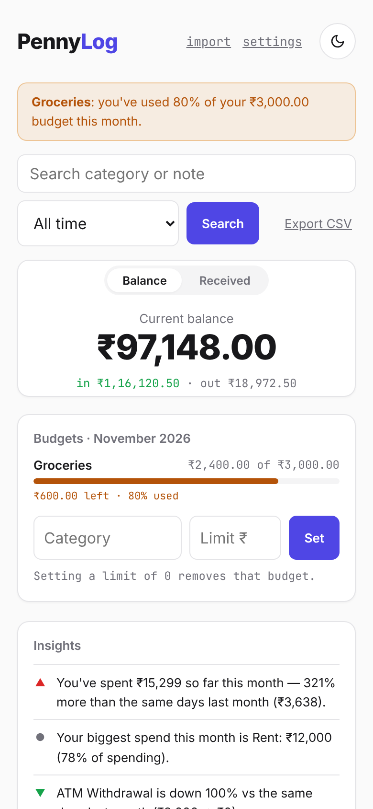
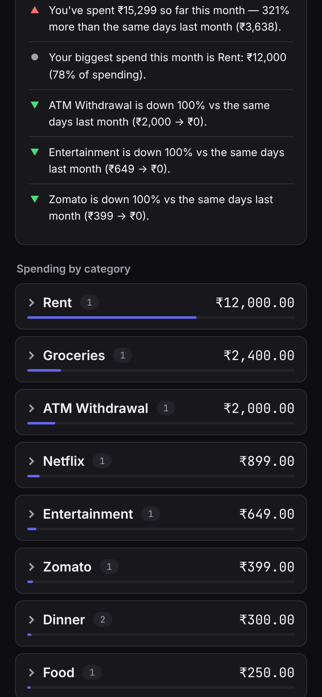
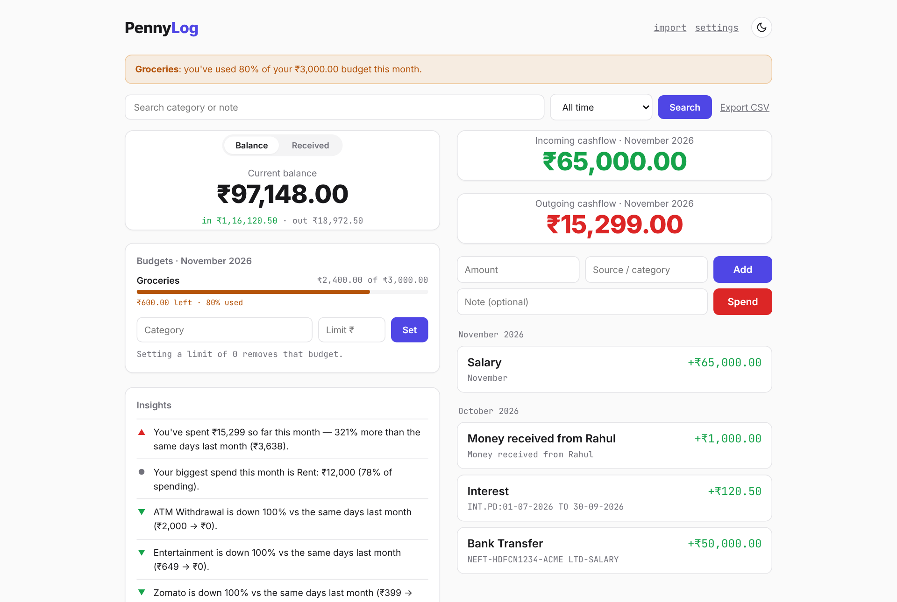

<div align="center">


# PennyLog

**A private, offline expense tracker built for India.**
Import your Paytm or bank statement, set budgets, see where your money goes.
No account. No server. No ads. Everything stays on your device.


</div>

<p align="center">
  
  &nbsp;
  
</p>
<p align="center">
  
</p>

---

##  Features

| | |
|---|---|
|  **Statement import** | CSV or Excel (`.xlsx`) from Paytm and banks (HDFC, ICICI, SBI, Axis, Kotak and similar). Merchant names are pulled from long narrations; re-importing skips duplicates. |
|  **Manual entries** | *Add* for money received, *Spend* for expenses. Edit or delete anything. |
|  **Balance & cashflow** | Current balance and this month's in/out, in rupees with lakh/crore grouping. |
|  **Categories** | Similar spellings (`Food`, `food `) merge into one, biggest spend first. |
|  **Budgets** | Monthly limit per category, with alerts at 80% and 100%. |
|  **Insights** | Pace vs. the same days last month, biggest spend, biggest movers, recurring payments. |
|  **Search & filters** | Search entries, filter by month. |
|  **Export & backup** | CSV export, plus full backup and restore from Settings. |
|  **Dark theme** | Follows your device. |

##  Privacy

PennyLog collects nothing and sends nothing anywhere. Entries, budgets and imported files are stored on your device only. No analytics, tracking or third-party services.
Full text: [PRIVACY.md](PRIVACY.md)

<details>
<summary><b> Project layout</b></summary>

```
www/                 the whole app: plain HTML / CSS / JS, no build step
  index.html         page shell
  app.js             screens and events (hash-routed)
  store.js           on-device data (localStorage), CSV export, backup / restore
  parser.js          CSV / Excel statement import
  insights.js        budgets, recurring payments, insights
  logic.js           dashboard numbers, grouping, filters
  format.js          rupee formatting, dates, HTML escaping
  files.js           saving files (share sheet on phones, download in browser)
  sw.js, manifest.webmanifest, icons   PWA files
android/             Capacitor Android project
tests/               tests, fixtures, golden output from the Python version
scripts/             gen_golden.py, db_to_backup.py
PUBLISHING.md        store publishing guide
```
</details>

<details>
<summary><b> Coming from the Flask version?</b></summary>

This is a ground-up offline port. Accounts, the database and Gmail sync were removed because they need a server. To carry your data over:

```bash
python3 scripts/db_to_backup.py /path/to/pennylog.db --user YOURNAME
```

Then in the app: **Settings → Restore from a backup**. Never commit `pennylog.db` or `secret.key`.
</details>

##  Known limits

- Bank statement layouts are based on commonly seen formats, not verified real files. If a file is rejected, the error lists the headers it found; add names to `COLUMN_HINTS` in `www/parser.js`.
- Data lives only on the device, so back it up (Settings) before uninstalling.
- Dates and "this month" use Indian Standard Time.
- No app lock (PIN / biometric) yet.

## 📄 License & credits

Released under the [MIT License](LICENSE).

Built with [Capacitor](https://capacitorjs.com) (MIT), [read-excel-file](https://gitlab.com/catamphetamine/read-excel-file) (MIT), and the [Inter](https://rsms.me/inter/) and [JetBrains Mono](https://www.jetbrains.com/lp/mono/) fonts (SIL Open Font License 1.1).
